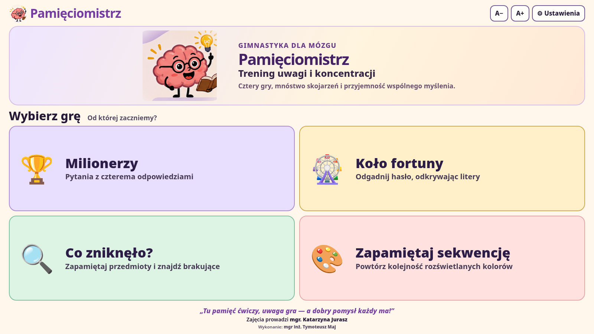
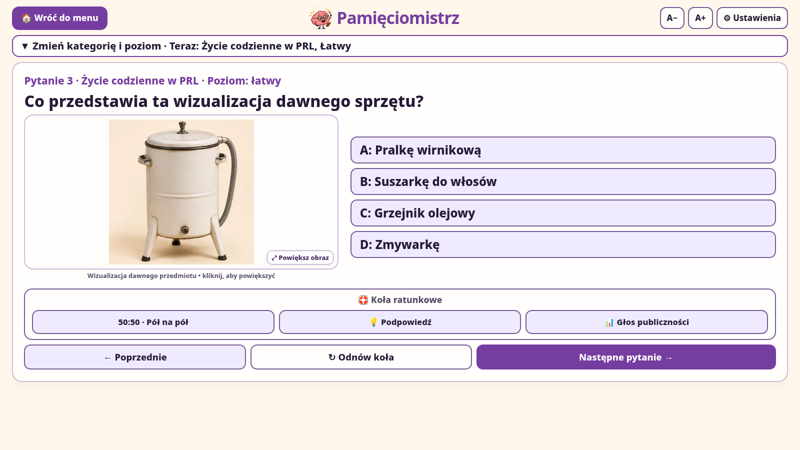
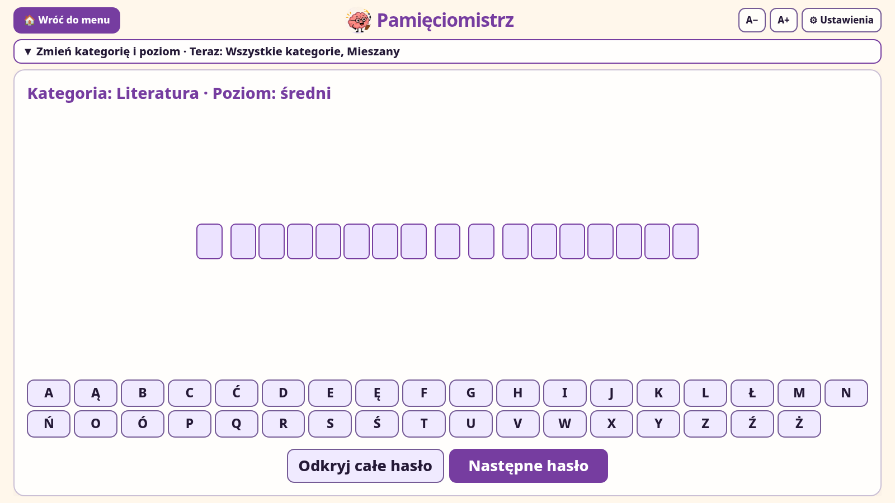
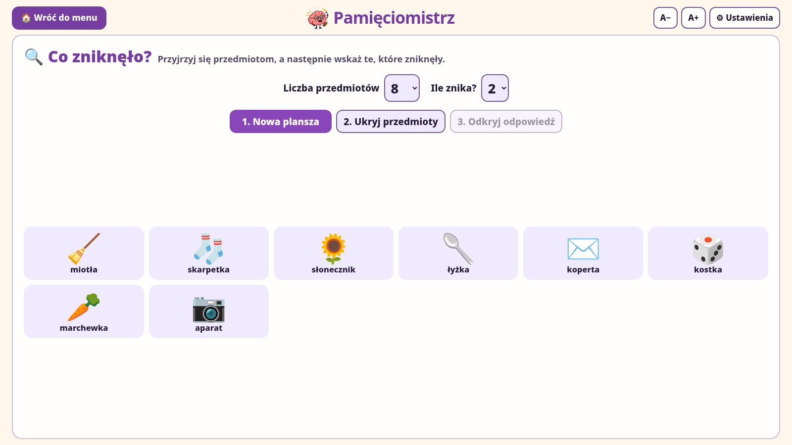
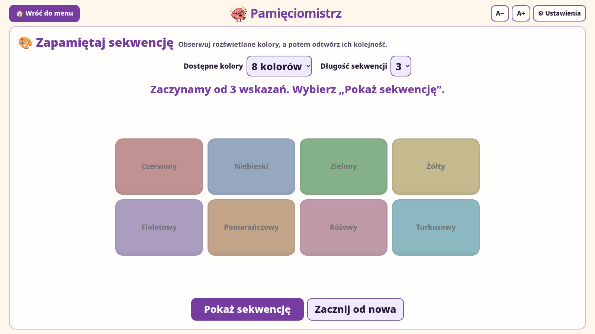

<div align="center">

# 🧠 PAMIĘCIOMISTRZ

### Gimnastyka dla mózgu — trening uwagi i koncentracji

**Cztery gry. Mnóstwo skojarzeń. Jedna wspólna zabawa.**

[](https://developer.mozilla.org/docs/Web/HTML)
[](https://developer.mozilla.org/docs/Web/CSS)
[](https://developer.mozilla.org/docs/Web/JavaScript)


<br>



<br>

**[▶ URUCHOM APLIKACJĘ](https://xeraoo.github.io/pamieciomistrz/)** · [📸 Zobacz zrzuty ekranu](#-galeria) · [🚀 Jak uruchomić](#-uruchomienie)

> *„Tu pamięć ćwiczy, uwaga gra — a dobry pomysł każdy ma!”*

</div>

---

## ✨ Co to jest Pamięciomistrz?

**Pamięciomistrz** to przeglądarkowa aplikacja edukacyjna przygotowana z myślą o seniorach uczestniczących w zajęciach **„Gimnastyka dla mózgu – trening uwagi i koncentracji”**.

Łączy popularne formaty zabawy z ćwiczeniami angażującymi uwagę, zapamiętywanie, rozpoznawanie, wiedzę ogólną i skojarzenia. Pytania nawiązują m.in. do polskich filmów, muzyki, telewizji, codzienności w PRL, dawnych przedmiotów i doświadczeń bliskich starszym pokoleniom.

Interfejs zaprojektowano do **pracy na rzutniku**, ale dostosowuje się też do laptopów, tabletów i telefonów.

## 🎮 Cztery gry, wiele możliwości

| Gra | Na czym polega? | Co oferuje? |
|:--|:--|:--|
| 🏆 **Milionerzy** | Wybierz prawidłową odpowiedź spośród czterech możliwości. | Pytania tekstowe i obrazkowe, kategorie, poziomy trudności, koła ratunkowe, powiększanie ilustracji. |
| 🎡 **Koło fortuny** | Odkrywaj litery i odgaduj hasła. | Tematyczne hasła, polskie znaki, wskazówki, wybór kategorii i trudności. |
| 🔎 **Co zniknęło?** | Zapamiętaj przedmioty, a następnie wskaż brakujące. | Od **6 do 20 przedmiotów** i regulowana liczba ukrywanych elementów (do 10). |
| 🎨 **Zapamiętaj sekwencję** | Obserwuj rozświetlane kolory i odtwórz ich kolejność. | Od **2 do 8 kolorów**, wybór początkowej długości sekwencji i stopniowanie trudności. |

### 🌟 Funkcje stworzone z myślą o uczestnikach

- **Duże i czytelne elementy** — wygodniejsze podczas prowadzenia zajęć na dużym ekranie.
- **A− / A+** — szybka regulacja rozmiaru tekstu.
- **Jasny i ciemny motyw** oraz **tryb wysokiego kontrastu**.
- **Tryb indywidualny i drużynowy** — punktacja dla 2, 3 lub 4 drużyn.
- **Koła ratunkowe** w Milionerach: 50:50, podpowiedź oraz głos publiczności (symulacja w trybie indywidualnym lub głosowanie drużyn).
- **Losowanie bez powtórzeń** w ramach dostępnej puli pytań i haseł oraz możliwość jej odnowienia.
- **Pełny ekran** — przydatny w sali zajęciowej.
- **Praca bez internetu** po pobraniu pliku HTML — grafiki wykorzystywane w aplikacji są osadzone w jej kodzie.

---

## 📸 Galeria

<table>
  <tr>
    <td align="center" width="50%">
      <b>🏆 Milionerzy — pytania obrazkowe</b><br><br>
      
    </td>
    <td align="center" width="50%">
      <b>🎡 Koło fortuny — odkrywanie haseł</b><br><br>
      
    </td>
  </tr>
  <tr>
    <td align="center">
      <b>🔎 Co zniknęło? — zapamiętywanie przedmiotów</b><br><br>
      
    </td>
    <td align="center">
      <b>🎨 Zapamiętaj sekwencję — do 8 kolorów</b><br><br>
      
    </td>
  </tr>
</table>

<details>
<summary><b>➕ Jak dodać tutaj własne screeny?</b></summary>

1. Zrób zrzut ekranu podczas działania aplikacji.
2. Umieść go w folderze `assets/screenshots/`, np. pod nazwą `06-gra-druzynowa.png`.
3. Dopisz w tej sekcji README:

```md

```

Możesz też **podmienić istniejący obraz**, pozostawiając jego nazwę — wtedy układ galerii nie wymaga zmian.

</details>

---

## 🧩 Tematy bliskie różnym pokoleniom

Baza obejmuje między innymi:

`📺 Seriale i telewizja` · `🎬 Polskie kino` · `🎵 Muzyka` · `📚 Literatura` · `🏠 Życie codzienne w PRL` · `🧸 Zabawy dzieciństwa` · `🍲 Tradycyjna kuchnia` · `⚽ Sport` · `🌿 Ogród i przyroda` · `🗺️ Polska` · `🛠️ Dawne zawody` · `💬 Przysłowia`

Kategorie i poziomy trudności można wybierać w aplikacji. Materiał obejmuje zarówno zagadnienia nostalgiczne, jak i bardziej ponadczasowe.

## 🚀 Uruchomienie

### Opcja 1 — bez instalacji

1. Pobierz plik **`index.html`**.
2. Otwórz go dwuklikiem w przeglądarce.
3. Wybierz grę i rozpocznij zabawę.

**Nie potrzebujesz serwera, instalatora ani konta użytkownika.**

### Opcja 2 — GitHub Pages

1. Utwórz publiczne repozytorium o nazwie `pamieciomistrz`.
2. Dodaj plik `index.html`, ten `README.md` oraz folder `assets/screenshots/`.
3. Wejdź w **Settings → Pages**.
4. Wybierz **Deploy from a branch**, gałąź `main`, folder `/(root)` i zapisz.
5. Otwórz adres `https://TWOJ-LOGIN.github.io/pamieciomistrz/`.

> **Ważne:** w linku na początku README zamień `TWOJ-LOGIN` na swoją nazwę użytkownika GitHub. Jeśli repozytorium ma inną nazwę niż `pamieciomistrz`, zmień też końcówkę adresu.

### Aktualizowanie aplikacji

Aby opublikować nowszą wersję, zastąp plik `index.html` w repozytorium i zatwierdź zmianę. Adres GitHub Pages pozostanie taki sam.

## 📁 Struktura repozytorium

```text
pamieciomistrz/
├── index.html
├── README.md
└── assets/
    └── screenshots/
        ├── 01-ekran-startowy.png
        ├── 02-milionerzy-obrazki.png
        ├── 03-kolo-fortuny.png
        ├── 04-co-zniknelo.png
        └── 05-sekwencje.png
```

## 🛠️ Technologie

**HTML5 · CSS3 · JavaScript**

Cała aplikacja działa po stronie przeglądarki. Nie wymaga frameworka ani zewnętrznego backendu. Ilustracje znajdują się bezpośrednio w pliku HTML; ustawienia użytkownika mogą być zapamiętywane lokalnie w przeglądarce.

## 👥 Autorzy

**Prowadzenie zajęć i koncepcja wykorzystania dydaktycznego**  
**mgr. Katarzyna Jurasz**

**Projekt i wykonanie aplikacji**  
**mgr inż. Tymoteusz Maj**

---

<div align="center">

### 🧠 Tu pamięć ćwiczy, uwaga gra!

*Pamięciomistrz powstał po to, by wspólna nauka była również dobrą zabawą.*

<sub>Aplikacja jest pomocą dydaktyczną i rekreacyjną; nie jest narzędziem diagnostycznym ani metodą leczenia zaburzeń poznawczych.</sub>

</div>
